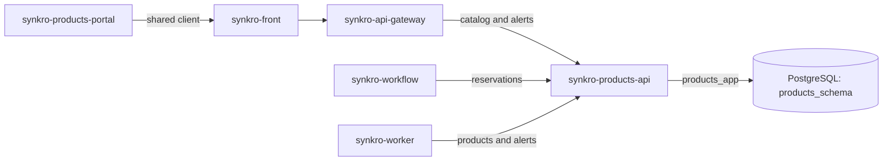

# synkro-products-api

> Products API for the catalog, categories, stock adjustments, reservations and low-stock alerts.

Part of the **SynkroTech SAS Sales Management System**. Architecture, decisions and
contracts live in [synkro-docs](https://github.com/code-corhuila/synkro-docs).

**Quick start:** from this repository's root, use Go 1.26.9 and run
`go run ./cmd/products-api` with a migrated PostgreSQL database, the restricted
`products_app` credentials and Auth's public key configured. See
[Getting started](#getting-started). For the complete Docker platform, start in
[synkro-infra-postgres](https://github.com/code-corhuila/synkro-infra-postgres).

## What it does

- Creates, reads, updates and logically deactivates products and categories.
- Records inventory adjustments, attributed to the verified token subject, and manages
  reservations used by the sale saga.
- Records an append-only price history for every price-changing update and serves it
  to ADMIN and INVENTORY users.
- Owns low-stock alerts opened and resolved by synkro-worker.
- Verifies RS256 tokens locally and checks roles or operation-specific permissions.
- Exposes a public database-aware health check with a one-second bound.

Schema changes belong to synkro-products-db. The PostgreSQL instance and application
login belong to synkro-infra-postgres.

## Where it fits



Workflow and Worker call the API on the internal `platform` network. Reservations
are internal; the gateway publishes catalog and alert routes. The API exposes
8080 inside Docker and publishes no host port in its Compose definition.

## Tech stack

| Component | Choice |
|---|---|
| Language and routing | Go 1.26.9; standard-library `net/http` |
| Persistence | PostgreSQL; `pgx/v5` |
| Authentication | RS256; `golang-jwt/jwt/v5` |
| Build and test | Go tools; Python coverage gate; Docker/Flyway integration fixture |
| Runtime | `alpine:3.23` container; listener on 8080 |

## Dependencies

| Depends on | Why | Configuration |
|---|---|---|
| Migrated PostgreSQL | Catalog, stock, reservations and alerts | `DATABASE_URL`, using `products_app` |
| synkro-products-db | Schema, migrations and grants | Apply owning migrations first |
| Auth public key | Local JWT verification | Exactly one public-key variable |
| synkro-api-gateway | Public entry point | Internal Docker DNS |
| Docker network `platform` | Container connectivity | External network in `deploy/compose.yml` |

## Getting started

<a id="running-locally"></a>

Run commands from this repository's root. Install Go 1.26.9 and obtain a database
migrated by synkro-products-db, its restricted credentials and Auth's public PEM.
The [configuration example](.env.example) lists inputs; `go run` does not
automatically load a `.env` file.

In **PowerShell**, after supplying those environment variables:

```powershell
go run ./cmd/products-api
```

In a second PowerShell window:

```powershell
Invoke-RestMethod http://localhost:8080/health
```

In **Bash**, the equivalent configuration uses placeholders, never real credentials
in committed files or recordings:

```bash
DATABASE_URL='postgres://products_app:<url-encoded-password>@localhost:5432/synkro?search_path=products_schema&sslmode=disable' \
JWT_PUBLIC_KEY_FILE=/absolute/path/to/auth-public.pem \
go run ./cmd/products-api
```

The database address must be reachable from the Go process. A database available
only on Docker's internal network is not reachable as `localhost:5432` on the host.
For container execution, use `deploy/compose.yml` through synkro-infra-postgres,
which supplies the internal address, public key and network.

## Configuration

| Variable | Purpose | Required/default |
|---|---|---|
| `HTTP_PORT` | HTTP listener | `8080` |
| `DATABASE_URL` | PostgreSQL URI for `products_app` and its schema | Required |
| `JWT_PUBLIC_KEY` | Public PEM; literal `\n` separators accepted | Exactly one key source |
| `JWT_PUBLIC_KEY_FILE` | Path to the public PEM | Exactly one key source |

The private signing key belongs only to Auth. Missing or invalid public keys
prevent startup. A valid key does not prove database availability.

## Interface

| Method and route | Authorization | Result |
|---|---|---|
| `GET /api/v1/products` and `/{id}` | ADMIN, SALESPERSON, INVENTORY or `products:read` | Catalog or product |
| `POST /api/v1/products`; `PUT` / `DELETE /{id}` | ADMIN, INVENTORY or `products:write` | Create, update or deactivate |
| `GET /api/v1/products/{id}/price-history` | Human ADMIN or INVENTORY with `products:read` | Price changes, newest first, paginated |
| `GET /api/v1/products/categories` | Catalog read access | Categories |
| `POST /api/v1/products/categories`; `PUT` / `DELETE /{id}` | Catalog write access | Create, rename or deactivate |
| `POST /api/v1/products/{id}/stock-adjustments` | Catalog write access | Adjustment and resulting stock; `adjustedBy` is the verified `sub` |
| `POST /api/v1/stock-reservations`; `GET /{id}` | `stock:reserve` | Reservation |
| `POST /api/v1/stock-reservations/{id}/release` | `stock:release` | Released reservation |
| `GET /api/v1/stock-alerts` | ADMIN, INVENTORY or `stock-alerts:read` | Alerts |
| `POST /api/v1/stock-alerts`; `POST /{id}/resolve` | `stock-alerts:write` | Open or resolve alert |
| `GET /health` | Public | 200 healthy; 503 when the store is unavailable |

The [Products OpenAPI contract](https://github.com/code-corhuila/synkro-docs/blob/main/07-api/contracts/openapi/synkro-products-api.yaml)
defines exact payloads and response codes; the price-history route is described in
[Product price history](docs/price-history-design.md) and its
[OpenAPI extension](docs/price-history.openapi.yaml). Health probes `products_schema.product`
through an application port; it includes UTC time and no connection diagnostics.

## Authentication

Every API route requires a locally verified token; `/health` remains public.
Invalid authentication returns a generic 401; insufficient access returns 403.
Only RS256 is accepted; `alg: none`, other algorithms, foreign keys, tampered or expired
tokens are rejected, and client-supplied author fields never replace the verified `sub`.
The [authentication guide](docs/authentication.md) preserves key, algorithm,
claims, clock-skew and trusted-identity details.

## Project structure

```text
cmd/products-api/       process entry point and dependency wiring
internal/
  domain/              business models and rules; no external dependencies
  application/         use cases and inbound/outbound ports
  adapter/             HTTP/security and PostgreSQL adapters
deploy/                Dockerfile and internal Compose service
scripts/               migration fixture, coverage and synchronization tools
test/products-db/      vendored migration fixture and source revision
docs/                  authentication, testing, price history and health design
```

## Running the tests

From the repository root, in PowerShell or Bash:

```text
go build ./...
go vet ./...
go test ./...
```

Unit and HTTP tests need Go. Some persistence tests skip without
`TEST_DATABASE_URL`; tagged health integration tests require real fixture URLs.
The [testing guide](docs/testing.md) preserves the disposable Docker/Flyway setup,
real integration commands, migration synchronization, coverage gate (domain 90%,
application 80%, infrastructure 60%, global 80%), negative-authentication, stock-author
and price-history suites. Price history needs synkro-products-db V021–V024 applied.

## Branching

Permanent branches are `develop`, `qa` and `main`; work enters through child
branches and PRs. Use `feat/`, `fix/` or `chore/` into `develop`,
`qa-<description>` into `qa`, and `release/` or `hotfix/` into `main`.
Promote with `git cherry-pick -x`; never merge permanent branches. `main` requires
approval from `ariel5253`. Use English Conventional Commits. See the
[Git conventions](https://github.com/code-corhuila/synkro-docs/blob/main/00-governance/git-conventions.md).

## Further documentation

- [Authentication](docs/authentication.md): preserved JWT verification details.
- [Testing](docs/testing.md): database setup, fixture maintenance, security and price-history tests.
- [Product price history](docs/price-history-design.md) and
  [OpenAPI extension](docs/price-history.openapi.yaml).
- [Store health design and evidence](docs/store-health-design.md).
- [Domain rules](https://github.com/code-corhuila/synkro-docs/blob/main/02-domain/entities-and-rules.md),
  [data models](https://github.com/code-corhuila/synkro-docs/blob/main/06-data/models.md)
  and [testing strategy](https://github.com/code-corhuila/synkro-docs/blob/main/11-quality/testing-strategy.md).
